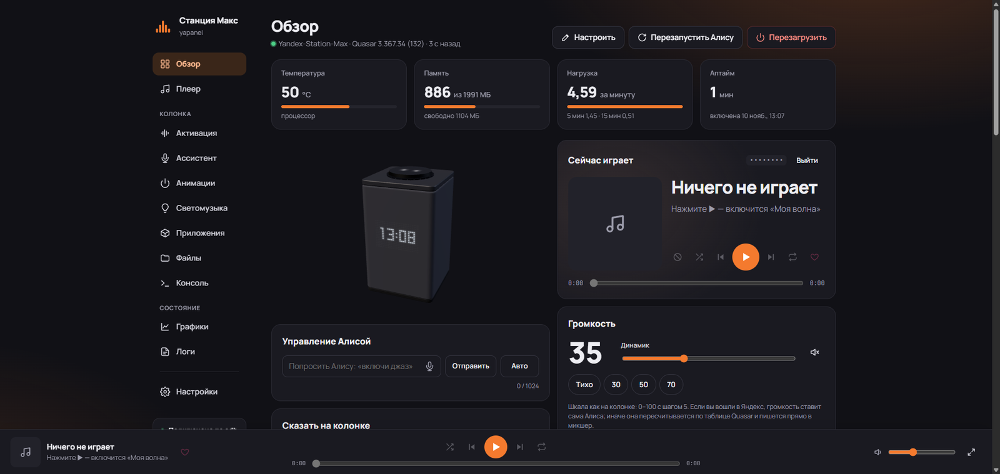
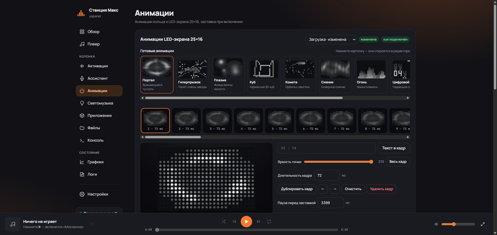
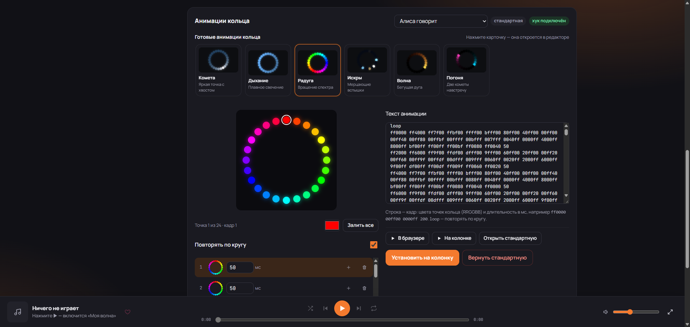
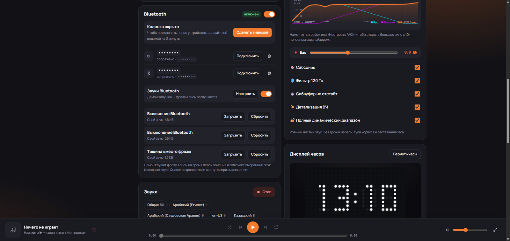
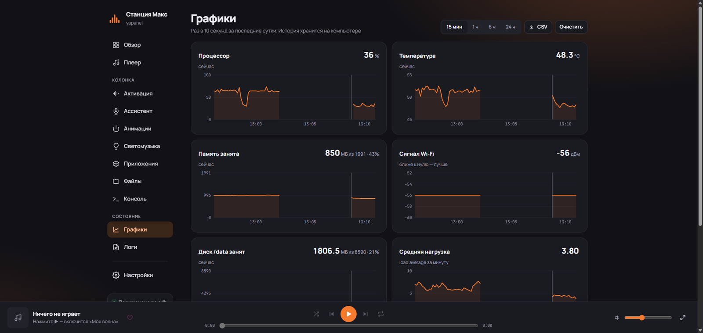
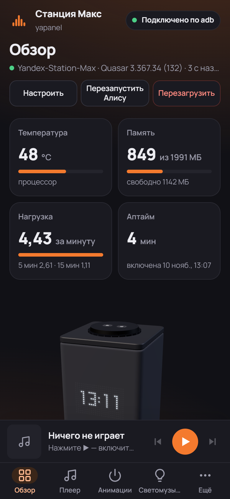

<div align="center">


# yapanel-web_max

**Панель управления Яндекс Станцией Макс**

Музыка, звук, свет, микрофоны, LED-экран и root-инструменты — в одном окне.  
Работает на самой колонке или на компьютере в той же Wi-Fi-сети.

[](https://github.com/Timobzdecc/yapanel-web_max/releases/latest)
[](#)
[](LICENSE)
[](https://github.com/Timobzdecc/yapanel-web_max)

</div>



> [!WARNING]
> Неофициальный проект, не связан с Яндексом и не одобрен им. Панель работает только на колонке, где **уже получен root-доступ по adb**, и сама колонку не рутирует. Консоль и файловый менеджер дают полный root-доступ к системе — используйте осознанно.

> [!NOTE]
> Проект находится в стадии **beta**: функции и установка могут меняться, возможны ошибки. Если что-то не работает — [откройте issue](https://github.com/Timobzdecc/yapanel-web_max/issues), приложив версию, модель станции и лог.

## 🎉 Что нового в 0.3.11

**Авто-детект root и правильное имя проекта.**

- **Панель сама находит root-транспорт:** `direct`, `su`, `su 0`, `sudo`, `/odm/bin/su` и другие абсолютные пути, а также очередь Hybrid `rootd`. Больше не нужно вручную объяснять панели, как на этой станции получают `uid=0`.
- **Установщик ищет `su` не только в `PATH`:** добавлены `/odm/bin/su`, `/system/xbin/su`, `/system/bin/su`.
- **Брендинг:** проект везде называется **yapanel-web_max**, а не просто «yapanel».

**Важно:** авто-детект `su`/`direct` проверен на живой станции, а `rootd` и fallback без `su` — только unit-тестами. На реальной rootd-only станции не проверялось. Если что-то не работает — **[откройте issue](https://github.com/Timobzdecc/yapanel-web_max/issues)**.

**[Скачать 0.3.11](https://github.com/Timobzdecc/yapanel-web_max/releases/tag/v0.3.11)** · **[Полный чейнжлог](https://github.com/Timobzdecc/yapanel-web_max/blob/main/docs/release-notes/v0.3.11.md)** · [Что было в 0.3.10](https://github.com/Timobzdecc/yapanel-web_max/blob/main/docs/release-notes/v0.3.10.md)

## 📸 Скриншоты

<table>
  <tr>
    <td width="50%">
      
      <br><b>Анимации LED-экрана</b><br>
      <sub>10 готовых пресетов: портал, плазма, куб, огонь, цифровой дождь и другие.</sub>
    </td>
    <td width="50%">
      
      <br><b>Кольцо 24 LED</b><br>
      <sub>Цветные пресеты, компактные кадры и правка цвета выбранной точки.</sub>
    </td>
  </tr>
  <tr>
    <td width="50%">
      
      <br><b>Звуки Bluetooth</b><br>
      <sub>Свои джинглы, тишина вместо фразы Алисы и автозапуск демона.</sub>
    </td>
    <td width="50%">
      
      <br><b>Мониторинг</b><br>
      <sub>Температура, память, нагрузка, Wi-Fi и диск — с историей за сутки.</sub>
    </td>
  </tr>
</table>

<details>
<summary><b>📱 Мобильная версия</b></summary>
<br>

</details>

## Зачем это нужно

- **Всё в одном месте.** Музыка, громкость, Bluetooth, радио, свет, DSP, слова активации, LED-матрица и root-инструменты — в одном интерфейсе.
- **Живёт на самой колонке.** Не нужен включённый компьютер: панель стартует вместе со станцией и работает с любого устройства в сети.
- **Не зависит от облака.** Светомузыка общается с лампами Tuya напрямую по Wi-Fi, музыка и управление идут через локальные сервисы. Интернет пропал — панель и свет продолжают работать.
- **Даёт доступ к железу.** Аппаратный DSP усилителей Silergy, Hi-Fi-калибровка, ночной режим, клубный бас — всё в пару кликов.
- **Свои слова активации.** Колонку можно научить реагировать на «Алёша» или «Джарвис», не заменяя штатную Алису и не занимая микрофон вторым приложением.
- **Свой AI-ассистент.** GPT, Claude, DeepSeek, Ollama — ответы можно озвучивать голосом Алисы или внешним TTS.
- **Светомузыка и Ambilight.** 12 пресетов, пространственное расположение ламп и синхронизация света с фильмом.
- **Понятные root-инструменты.** Консоль, файлы, логи, температура и память — без запоминания adb-команд.

## 🚀 Установка

### Windows — самый простой путь

Python на компьютер ставить не нужно.

[](https://github.com/Timobzdecc/yapanel-web_max/releases/download/v0.3.11/yapanel-web-0.3.11-windows-x64.zip)
[](https://github.com/Timobzdecc/yapanel-web_max/releases/download/v0.3.11/yapanel-web-0.3.11-windows-arm64.zip)

1. Скачайте архив и распакуйте его.
2. Запустите **`install_to_max.bat`**.
3. Введите IP станции, например `192.168.1.100`.

Установщик сам проверит adb и root, подключится к станции, доустановит нужные библиотеки, зальёт панель в `/data/yapanel`, разложит файлы слов активации в `/data/wakeword` (включая `frida-inject`, negatives и jar), настроит автозапуск и откроет панель в браузере.

Если что-то пойдёт не так — нет ADB, root или Python — он напишет понятную ошибку и не закроет окно.

Нужны только **root** и **Python 3** на колонке. Отдельные `maxctl` и `YAM` для слов активации не требуются.

### Linux — установка из исходников

Панель написана на Python и использует только стандартную библиотеку — `pip install` не нужен. Нужны Python 3.9+, `adb` и, желательно, `ffmpeg` и `openssl`. Root нужен только на станции; на Linux-хосте панель работает от обычного пользователя.

#### 1. Зависимости

**Ubuntu / Debian / Linux Mint**

```bash
sudo apt update
sudo apt install -y python3 adb ffmpeg openssl git
```

**Fedora**

```bash
sudo dnf install -y python3 android-tools ffmpeg openssl git
```

**Arch Linux / Manjaro**

```bash
sudo pacman -S --needed python android-tools ffmpeg openssl git
```

**openSUSE**

```bash
sudo zypper install -y python3 android-tools ffmpeg openssl git
```

Проверьте версии:

```bash
python3 --version    # 3.9 или новее
adb version          # platform-tools 28+ / adb 1.0.39+
ffmpeg -version      # необязательно, но нужен для MP3/OGG
openssl version      # необязательно, нужен для HTTPS
```

Если в дистрибутиве старый `adb`, поставьте свежие [Android platform-tools](https://developer.android.com/tools/releases/platform-tools) вручную и положите `adb` в `PATH`.

#### 2. Скачать и запустить

```bash
git clone https://github.com/Timobzdecc/yapanel-web_max.git
cd yapanel-web_max
chmod +x start.sh
./start.sh 192.168.1.50 --host 0.0.0.0 --data-dir ./data
```

`start.sh` сам откроет браузер и передаст IP станции в панель. Если браузер не нужен (сервер, SSH):

```bash
python3 server.py \
  --device 192.168.1.50 \
  --host 0.0.0.0 \
  --port 8765 \
  --https-port 8766 \
  --data-dir ./data
```

- `--host 0.0.0.0` — доступ с других устройств в сети. Без него панель слушает только `127.0.0.1`.
- `--data-dir ./data` — токен, пароль, сертификаты и история графиков. Не храните эту папку в git.
- `--find` — если IP станции неизвестен: `./start.sh --find` или `./start.sh --find 192.168.1.0/24`.

Пример с автопоиском и доступом по сети:

```bash
./start.sh --find --host 0.0.0.0 --data-dir ./data
```

`start.sh` всегда добавляет `--open`; на headless-сервере это просто попытка открыть браузер, на работу панели не влияет.

#### 3. Проверить ADB и root

Перед запуском панели убедитесь, что компьютер видит станцию:

```bash
adb connect 192.168.1.50:5555
adb devices
```

В списке должна быть строка `192.168.1.50:5555` со статусом `device`. Если `offline`:

```bash
adb disconnect 192.168.1.50:5555
adb connect 192.168.1.50:5555
```

Если ADB завис после перезагрузки станции:

```bash
adb kill-server
adb start-server
adb connect 192.168.1.50:5555
```

Проверьте root-транспорт:

```bash
adb -s 192.168.1.50:5555 shell 'id; su -c id; /odm/bin/su -c id'
```

Хотя бы одна строка должна быть `uid=0(root)`. Варианты:

- `direct` — `adb shell` уже root (например, buildroot-прошивки);
- `su` или `/odm/bin/su` — обычный `su` на Максе;
- Hybrid `rootd` — панель найдёт очередь сама; на живой rootd-only станции этот путь пока не проверялся;
- `sudo` — унаследованный fallback, на станциях почти не встречается.

Если root нет ни одним способом, панель не сможет управлять станцией. Это не ошибка установки — сначала нужен root на самой колонке.

Установщик для Windows использует `direct` / `su` / `su 0` / `sudo` и абсолютные пути `su`. Hybrid `rootd` он не использует: на rootd-only станции панель ставьте вручную или запускайте через Docker.

#### 4. Открыть панель

На этом же компьютере: <http://127.0.0.1:8765/><br>
С телефона или другого ПК: `http://<IP-компьютера>:8765/`

Проверить, что панель отвечает:

```bash
curl -s -o /dev/null -w "%{http_code}\n" http://127.0.0.1:8765/
```

При первом запуске пароля нет. Задайте его в **Настройки → Доступ**, иначе панель будет открыта всем в сети.

Для HTTPS (нужен для микрофона в браузере):

1. Откройте `https://<IP-компьютера>:8766/`.
2. Скачайте корневой сертификат: `http://<IP-компьютера>:8765/ca.crt`.
3. Установите его на телефон/ПК как доверенный CA.

Если `openssl` не установлен или HTTPS не нужен, запускайте с `--https-port 0`.

#### 5. Автозапуск (systemd, по желанию)

Пользовательская служба — панель работает от вашего пользователя, root на компьютере не нужен. `loginctl enable-linger` может попросить пароль администратора.

```bash
mkdir -p ~/.config/systemd/user
cat > ~/.config/systemd/user/yapanel-web-max.service <<'EOF'
[Unit]
Description=yapanel-web_max
After=network-online.target

[Service]
WorkingDirectory=%h/yapanel-web_max
ExecStart=/usr/bin/python3 server.py --device 192.168.1.50 --host 0.0.0.0 --port 8765 --https-port 8766 --data-dir %h/yapanel-web_max/data
Restart=on-failure

[Install]
WantedBy=default.target
EOF

systemctl --user daemon-reload
systemctl --user enable --now yapanel-web-max
loginctl enable-linger "$USER"
```

Проверка и логи:

```bash
systemctl --user status yapanel-web-max
journalctl --user -u yapanel-web-max -f
```

Если панель лежит не в `~/yapanel-web_max`, замените пути в `WorkingDirectory` и `ExecStart`. Пользователь должен иметь доступ к `adb` и папке с данными.

#### 6. Firewall

Если панель не открывается с телефона, разрешите порты.

Ubuntu/Debian с ufw:

```bash
sudo ufw allow 8765/tcp
sudo ufw allow 8766/tcp
```

Fedora/RHEL с firewalld:

```bash
sudo firewall-cmd --permanent --add-port=8765/tcp --add-port=8766/tcp
sudo firewall-cmd --reload
```

#### 7. Обновление

```bash
cd ~/yapanel-web_max
git pull --ff-only
```

Если панель запущена через systemd:

```bash
systemctl --user restart yapanel-web-max
```

Если вручную — остановите процесс (`Ctrl+C`) и запустите снова. Папка `data` с токеном, паролем и историей при обновлении не затрагивается. После обновления обновите страницу с `Ctrl+F5`.

### Docker — Linux-сервер или NAS

Готовый образ проекта: `ghcr.io/timobzdecc/yapanel-web_max`. Есть теги `latest` и версии, например `0.3.11`. Поддерживаются `linux/amd64`, `linux/arm64` и `linux/arm/v7` (Raspberry Pi).

Внутри контейнера уже есть Python, `adb`, `ffmpeg` и `openssl`. На хосте нужен только Docker с Compose.

> [!IMPORTANT]
> Используйте `network_mode: host`. В этом режиме контейнер видит станцию в локальной сети, а HTTPS-сертификат выписывается на адреса хоста. С обычным bridge-режимом автопоиск станции и HTTPS из коробки работать не будут.

#### 1. Подготовить папку

```bash
mkdir -p ~/yapanel-web_max
cd ~/yapanel-web_max
mkdir -p data
chmod 700 data
```

`data` — это токен Яндекса, пароль панели, сертификаты, история графиков и ключи adb. Не выкладывайте её в git.

#### 2. `compose.yaml`

```yaml
services:
  panel:
    image: ghcr.io/timobzdecc/yapanel-web_max:0.3.11
    container_name: yapanel-web-max
    network_mode: host
    environment:
      ADB_SERIAL: "192.168.1.50"     # IP станции; порт 5555 подставится сам
      PANEL_PORT: "8765"             # HTTP
      PANEL_HTTPS_PORT: "8766"       # HTTPS; 0 — выключить
      PANEL_DATA_DIR: "/data"
    volumes:
      - ./data:/data
    restart: unless-stopped
```

В репозитории уже есть готовый `docker-compose.yml` (`network_mode: host`, том `./data`) — замените в нём `ADB_SERIAL` на IP станции.

Запуск:

```bash
docker compose pull
docker compose up -d
docker compose logs -f panel
```

Откройте `http://<IP-сервера>:8765/`. Пароль задаётся в **Настройки → Доступ**.

Если на сервере включён ufw или firewalld, разрешите `8765/tcp` и `8766/tcp` — команды в разделе [Linux → Firewall](#6-firewall).

#### 3. Или одной командой `docker run`

```bash
docker run -d \
  --name yapanel-web-max \
  --network host \
  --restart unless-stopped \
  -e ADB_SERIAL=192.168.1.50 \
  -e PANEL_PORT=8765 \
  -e PANEL_HTTPS_PORT=8766 \
  -v "$HOME/yapanel-web_max/data:/data" \
  ghcr.io/timobzdecc/yapanel-web_max:0.3.11
```

Проверка:

```bash
docker ps --filter name=yapanel-web-max
docker logs --tail 50 yapanel-web-max
curl -s -o /dev/null -w "%{http_code}\n" http://127.0.0.1:8765/
```

#### 4. Проверить ADB внутри контейнера

```bash
docker exec -it yapanel-web-max adb devices
docker exec -it yapanel-web-max adb connect 192.168.1.50:5555
docker exec -it yapanel-web-max adb -s 192.168.1.50:5555 shell 'id; su -c id; /odm/bin/su -c id'
```

`adb` внутри контейнера использует свой сервер на порту `5038` (`ANDROID_ADB_SERVER_PORT`), чтобы не конфликтовать с `adb` на хосте.

Если `adb devices` пуст:

1. Проверьте, что станция пингуется: `ping -c 3 192.168.1.50`.
2. Проверьте порт: `nc -vz 192.168.1.50 5555`.
3. Убедитесь, что контейнер запущен с `network_mode: host`.
4. Перезапустите: `docker compose restart`.
5. Посмотрите логи: `docker compose logs --tail 100 panel`.

#### 5. Обновление

Если в `compose.yaml` закреплена версия, замените `0.3.11` на новую. Если используется `:latest`, версия подтянется сама. Затем:

```bash
docker compose pull
docker compose up -d
```

`docker compose` — это плагин Compose V2. Если установлен старый `docker-compose`, команды те же, но с дефисом.

Проверить версию можно в **Настройки → О программе** или в логе запуска:

```bash
docker logs yapanel-web-max 2>&1 | grep -m1 "Панель"
```

#### 6. Остановка и удаление

```bash
docker compose down          # остановить, папка data сохраняется
```

Папку `data` удаляйте вручную — там ваши токены и настройки. Перед удалением сделайте резервную копию.

#### Docker Desktop (Windows / macOS)

`network_mode: host` в Docker Desktop работает ограниченно. Для панели на Windows/macOS проще использовать готовый Windows-установщик или запускать `start.bat` / `start.command` напрямую. Если всё же нужен контейнер:

- используйте `ports: ["8765:8765", "8766:8766"]` вместо `network_mode: host`;
- задайте `ADB_SERIAL` явно — автопоиск `--find` из bridge-сети не работает;
- для HTTPS укажите `PANEL_HTTPS_PORT=0` или проксируйте через reverse proxy: самоподписанный сертификат выписан на адреса контейнера, а не хоста.

### На самой колонке

Станция Макс — полноценный ARM-компьютер, панель на ней работает без внешнего сервера. Положите файлы в `/data/yapanel` и запустите:

```bash
adb shell "/data/python/bin/python3 /data/yapanel/server.py --host 0.0.0.0 --port 8765 --device local"
```

Автозапуск на Максе идёт через `adbd_watchdog.sh`, который при загрузке вызывает `/data/quasar/webpanel/boot_hook.sh`. Этот хук панель создаёт сама — править `rootkeeper.sh` не нужно. Включить автозапуск можно в настройках панели.

<details>
<summary><b>macOS</b></summary>

```bash
brew install python ffmpeg
brew install --cask android-platform-tools
git clone https://github.com/Timobzdecc/yapanel-web_max.git
cd yapanel-web_max
sh start.command
```

`start.command` можно запускать двойным кликом из Finder. Для доступа с других устройств добавьте `--host 0.0.0.0`:

```bash
sh start.command 192.168.1.50 --host 0.0.0.0
```

</details>

### Если что-то не работает

| Симптом | Что проверить |
|---|---|
| `adb: command not found` | Установите `adb` / Android platform-tools и проверьте `adb version` |
| `adb devices` пуст | Включён ли ADB по сети и доступен ли `192.168.1.50:5555`; выполните `adb connect ...` |
| `unauthorized` | Подтвердите ключ ADB на станции или удалите старый ключ и подключитесь заново |
| `Connection refused` | На станции не запущен `adbd` на `5555`; включите ADB по сети |
| Нет `uid=0(root)` | На станции нет доступного root-транспорта; панель не сможет управлять станцией |
| Панель открылась, но станция «offline» | Проверьте `adb devices` и лог панели; в Docker — `docker compose logs` |
| Нет HTTPS/микрофона | Установите `openssl`, откройте порт `8766` и доверьте `ca.crt` |
| Забыли пароль | Остановите панель, удалите `.panel_auth.json` в папке данных (обычно `./data`) и задайте пароль заново |
| После обновления старая версия | Обновите страницу с `Ctrl+F5`; проверьте версию в настройках |

Проект в стадии **beta**. Если что-то не работает — [откройте issue](https://github.com/Timobzdecc/yapanel-web_max/issues) и приложите:

- версию панели (Настройки → О программе);
- модель станции и версию прошивки;
- вывод `adb devices`;
- последние строки лога панели (`journalctl` или `docker compose logs`).

## Что умеет панель

### 🎵 Музыка и звук

Трек, исполнитель, обложка, прогресс и перемотка. Тексты песен подтягиваются из Яндекс Музыки и [LRCLIB](https://lrclib.net) и подсвечиваются в такт — получается караоке. Ещё есть очередь, похожие треки, громкость по таблице Quasar или напрямую через микшер, Bluetooth-треки и интернет-радио.

### 🎛️ Звук и DSP

Панель общается с усилителями Silergy SY6045S напрямую по I2C и настраивает аппаратные фильтры. Отсюда — пресеты **Hi-Fi Studio Flat**, **Ночной**, **Deep Punch** и **Club Bass**, регулятор баса от −6 до +8 дБ, график АЧХ, отключение компрессора DRC и аккуратный ресемплинг Lossless 44.1 → 48 кГц. Всё доступно и через REST API.

### 💡 Светомузыка и Ambilight

Лампы Tuya, Smart Life, MOES и Gauss управляются локально, без облака. В панели 12 пресетов — от океана и костра до киберпанка и диско. Можно указать, где стоит каждая лампа, включить бегущие волны, «радар» и режим кинотеатра с синхронизацией по таймкоду фильма.

Для локального управления нужен `local_key` лампы. Его можно получить через [iot.tuya.com](https://iot.tuya.com) и `python -m tinytuya wizard`, из Home Assistant или найти лампы прямо в панели: «Светомузыка» → «Поиск в Wi-Fi».

### 🎙 Свои слова активации

Колонку можно научить слову «Алёша», «Джарвис» или любому другому. Записи и модель хранятся на станции в `/data/wakeword` и никуда не отправляются.

Активация идёт через штатный SDK: Frida-агент внутри `com.yandex.io.sdk` вызывает `startConversation()`. Микрофон остаётся у SDK, второй `AudioRecord` не создаётся, штатная Алиса продолжает работать. В панели есть запись, обучение с прогрессом, чувствительность, история срабатываний и автозапуск. API демона слушает только `127.0.0.1:8780`.

Автор оригинала — [tangenx](https://github.com/tangenx), проект [station-wakeword](https://github.com/tangenx/station-wakeword). Порт для Макса и интеграция в панель — доработка этого форка.

### 🤖 Свой AI-ассистент

Запросы можно отправлять в GPT-4o, Claude, DeepSeek, Groq, OpenRouter или локальные модели через Ollama / LM Studio. Ассистент слушает речевой стек Android, при триггерной фразе останавливает Алису и отвечает сам — голосом Алисы или внешним TTS.

### 💡 LED-матрица, кольцо и 3D-модель

Матрица 25×16 показывает время, погоду, текст и анимации, а во время музыки — эквалайзер. Кольцо из 24 RGB-светодиодов настраивается по цвету и яркости. В браузере есть живая 3D-модель станции: видно, что показывает экран и как светится кольцо.

### ⚙️ Root-инструменты

Консоль на xterm.js с PTY и автодополнением, файловый менеджер по `/data` и системным разделам, температура, память, Load Average, перезапуск Алисы, `logcat` и `dmesg`.

### 🔒 Безопасность

Пароль с PBKDF2, проверка Origin/CSRF и локальный HTTPS для микрофона браузера. Всё общение — по локальной сети.

## ⚙️ Параметры командной строки

| Аргумент | Переменная | По умолчанию | Описание |
|---|---|---|---|
| `--device` | `ADB_SERIAL` | Сохранённый адрес | IP станции, USB-серийник или `local` для запуска на колонке |
| `--find` | `PANEL_FIND` / `PANEL_FIND_SUBNET` | — | Найти станцию в сети (подсеть или `auto`) |
| `--host` | `PANEL_HOST` | `127.0.0.1` | Интерфейс (`0.0.0.0` — доступ с других устройств) |
| `--port` | `PANEL_PORT` | `8765` | HTTP-порт панели |
| `--https-port` | `PANEL_HTTPS_PORT` | `8766` | HTTPS-порт для микрофона браузера (`0` — выключить) |
| `--data-dir` | `PANEL_DATA_DIR` | Папка с `server.py` | Где хранить настройки и метрики |
| `--open` | `PANEL_OPEN_BROWSER` | — | Открыть панель в браузере после старта |

## 🧪 Разработка

```bash
python -m pytest tests -q
node tests/test_ui_hardening.mjs
node tests/test_anim_presets.mjs
```

Панель — Python + ванильный JS без сборки: `server.py`, `api/`, `static/`. Устройство подключается через `adb`; на самой станции панель работает в режиме `--device local`.

## Лицензия и благодарности

* Код панели — **[MIT](LICENSE)**.
* База — **yapanel-web** / **[dimap](https://github.com/dimap/yandex-station-web)**, адаптированная под Станцию Макс.
* Вкладка «Активация» — проект **[station-wakeword](https://github.com/tangenx/station-wakeword)** автора **[tangenx](https://github.com/tangenx)**; порт для Макса, Frida-активация и интеграция в панель — доработка форка.
* `frida-inject` — [Frida](https://frida.re), LGPL-2.1.
* [three.js](https://threejs.org), [xterm.js](https://xtermjs.org), [QRCode.js](https://davidshimjs.github.io/qrcodejs/) — MIT.
* Тексты песен — [LRCLIB](https://lrclib.net).
* Протокол Glagol — спасибо сообществу [YandexStation для Home Assistant](https://github.com/AlexxIT/YandexStation).

*«Яндекс», «Алиса» и «Яндекс Станция» — товарные знаки ООО «Яндекс». Проект независимый и не связан с компанией.*
